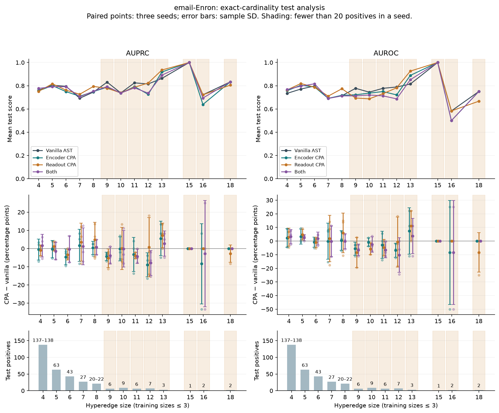
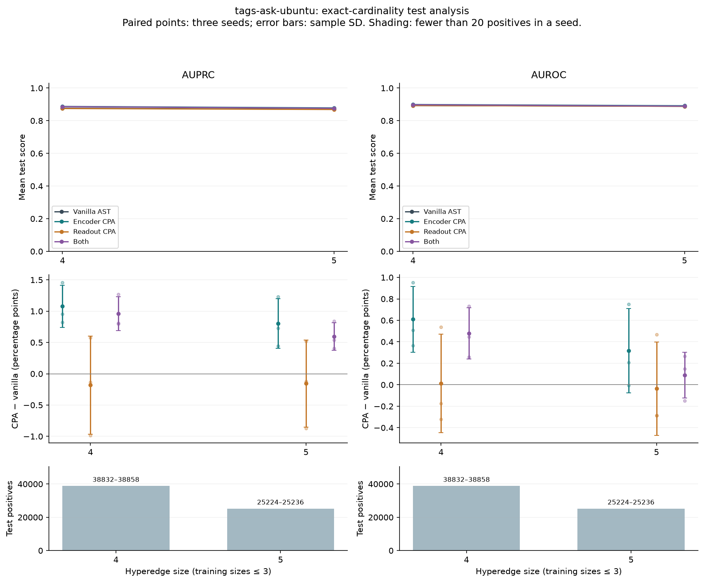

# Current test results by exact cardinality

Descriptive analysis of the verified current campaign. No retraining, resampling, tuning or legacy inputs. Every exact size is retained; sparse means fewer than 20 positives in any seed. AUPRC is average precision, matching the campaign implementation. Counts below are positives per seed; negatives match 1:1.

Means and sample SDs use three paired split/initialization seeds, not independent datasets or confidence intervals. Seed target sets overlap; no significance claim is made. Within-size AP does not average to pooled AP. Scores across sizes use different candidate populations, so their slopes alone do not establish extrapolation behavior.

## email-Enron

| Size | Positive count range | Sparse | Encoder Δ AUPRC (pp) | Readout Δ AUPRC (pp) | Both Δ AUPRC (pp) | Encoder Δ AUROC (pp) |
|---:|---:|:---:|---:|---:|---:|---:|
| 4 | 137–138 | no | -0.54 ± 5.75 | -0.93 ± 2.89 | +1.60 ± 6.26 | +2.28 ± 6.84 |
| 5 | 63–63 | no | -0.39 ± 4.77 | +1.18 ± 2.51 | -1.35 ± 4.79 | +3.28 ± 5.46 |
| 6 | 43–43 | no | -4.57 ± 4.33 | -3.33 ± 3.01 | -0.36 ± 7.25 | -0.81 ± 3.70 |
| 7 | 27–27 | no | +1.73 ± 8.86 | +3.46 ± 10.46 | +1.23 ± 10.18 | -0.09 ± 13.24 |
| 8 | 20–22 | no | +0.41 ± 3.63 | +4.86 ± 9.53 | +0.70 ± 4.14 | +0.43 ± 7.19 |
| 9 | 6–6 | yes | -4.34 ± 2.32 | -5.31 ± 5.17 | -3.83 ± 4.68 | -5.56 ± 4.81 |
| 10 | 9–9 | yes | -0.23 ± 6.59 | +0.08 ± 11.56 | -0.09 ± 10.08 | -0.82 ± 3.11 |
| 11 | 6–6 | yes | -3.23 ± 9.34 | -3.80 ± 1.67 | -4.26 ± 3.91 | -2.78 ± 10.02 |
| 12 | 7–7 | yes | -8.95 ± 6.66 | +0.80 ± 16.28 | -7.93 ± 6.80 | -6.80 ± 5.14 |
| 13 | 3–3 | yes | +5.56 ± 9.48 | +7.22 ± 6.74 | +2.78 ± 6.94 | +7.41 ± 16.97 |
| 15 | 1–1 | yes | +0.00 ± 0.00 | +0.00 ± 0.00 | +0.00 ± 0.00 | +0.00 ± 0.00 |
| 16 | 2–2 | yes | -8.33 ± 22.05 | +0.00 ± 0.00 | -2.78 ± 29.27 | -8.33 ± 38.19 |
| 18 | 2–2 | yes | +0.00 ± 0.00 | -2.78 ± 4.81 | +0.00 ± 0.00 | +0.00 ± 0.00 |

## tags-ask-ubuntu

| Size | Positive count range | Sparse | Encoder Δ AUPRC (pp) | Readout Δ AUPRC (pp) | Both Δ AUPRC (pp) | Encoder Δ AUROC (pp) |
|---:|---:|:---:|---:|---:|---:|---:|
| 4 | 38832–38858 | no | +1.08 ± 0.34 | -0.18 ± 0.78 | +0.96 ± 0.27 | +0.61 ± 0.31 |
| 5 | 25224–25236 | no | +0.80 ± 0.40 | -0.16 ± 0.70 | +0.60 ± 0.22 | +0.32 ± 0.39 |

## Interpretation

AskUbuntu: encoder CPA improves AUPRC at both test sizes in all three seeds. The mean gain is smaller at size 5 than size 4, so this does not support increasing advantage with order gap. Readout-only scaling has slightly negative mean AP differences at both sizes; combining it with encoder scaling yields smaller gains than encoder-only.

Enron: no monotonic encoder-CPA advantage across sizes 4–8; size 6 has a mean AP loss of 4.57 percentage points. Sizes above 8 contain only 1–9 positives per exact size per seed. Large tail-bin fluctuations are not strong evidence for or against generalization at large orders.

All 24 prediction files were checked against saved candidate labels/sizes and shared split identities. Recomputed exact-size AUPRC/AUROC matched every stored by-size metric exactly. Source file hashes and complete per-seed/model scores are in analysis.json and per_seed.csv.
