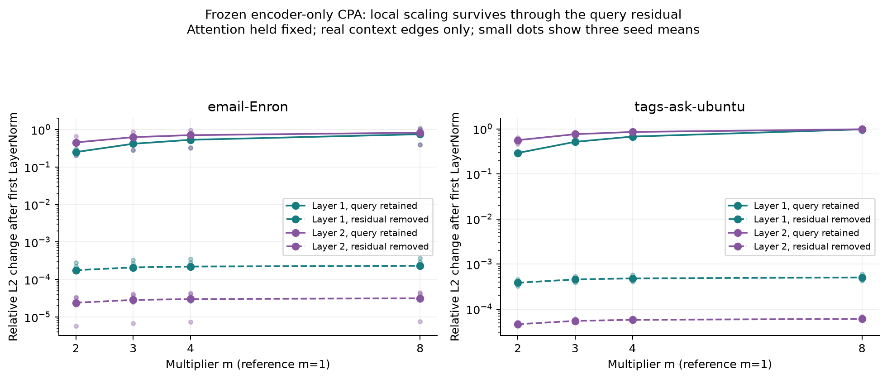

# Fresh encoder diagnostics (validation only)

Frozen encoder-only and combined CPA checkpoints from the verified current campaign; both datasets; seeds 0,1,2. All 12 normal and restored validation logit replays are bitwise exact. Checkpoint files and in-memory weights remained unchanged. No retraining, test scoring, condition selection or legacy results.

## Downstream interventions

Only encoder node-to-hyperedge multipliers change. Synthetic singleton self-messages retain m=1; readout and classifier are unchanged. Shuffling permutes actual sizes 2/3 among real context edges, preserving counts; one permutation is reused across layers. Three deterministic shuffles are averaged within each seed before computing across-seed SD.

| Dataset | Model | Condition | Validation AP | AP change (pp) | Validation AUROC | Mean absolute logit change |
|---|---|---|---:|---:|---:|---:|
| email-Enron | Encoder CPA | normal | 0.7109 | +0.000 +/- 0.000 | 0.6861 | 0.0000 |
| email-Enron | Encoder CPA | disabled | 0.6304 | -8.046 +/- 2.210 | 0.6199 | 0.8724 |
| email-Enron | Encoder CPA | constant3 | 0.6794 | -3.145 +/- 4.853 | 0.6801 | 0.4497 |
| email-Enron | Encoder CPA | shuffled | 0.6866 | -2.426 +/- 0.268 | 0.6764 | 0.1627 |
| email-Enron | Both | normal | 0.7135 | +0.000 +/- 0.000 | 0.6932 | 0.0000 |
| email-Enron | Both | disabled | 0.5963 | -11.724 +/- 2.945 | 0.5913 | 0.5005 |
| email-Enron | Both | constant3 | 0.6649 | -4.866 +/- 7.474 | 0.6729 | 0.3393 |
| email-Enron | Both | shuffled | 0.7045 | -0.908 +/- 0.925 | 0.6860 | 0.1470 |
| tags-ask-ubuntu | Encoder CPA | normal | 0.8833 | +0.000 +/- 0.000 | 0.8901 | 0.0000 |
| tags-ask-ubuntu | Encoder CPA | disabled | 0.4510 | -43.236 +/- 12.232 | 0.4389 | 3.3363 |
| tags-ask-ubuntu | Encoder CPA | constant3 | 0.8834 | +0.006 +/- 0.024 | 0.8899 | 0.3247 |
| tags-ask-ubuntu | Encoder CPA | shuffled | 0.8831 | -0.025 +/- 0.011 | 0.8899 | 0.1187 |
| tags-ask-ubuntu | Both | normal | 0.8835 | +0.000 +/- 0.000 | 0.8907 | 0.0000 |
| tags-ask-ubuntu | Both | disabled | 0.4561 | -42.740 +/- 4.692 | 0.4417 | 3.1444 |
| tags-ask-ubuntu | Both | constant3 | 0.8827 | -0.080 +/- 0.112 | 0.8899 | 0.4385 |
| tags-ask-ubuntu | Both | shuffled | 0.8830 | -0.049 +/- 0.065 | 0.8904 | 0.1596 |

## Local normalization check

Normal upstream inputs and raw attention are fixed separately in each encoder layer. Compare m=3 with m=1 in the same checkpoint and real edge. The zero-query control removes only the query added to the pooled vector; the query used to compute attention is preserved. Local reconstructions exactly match source forward for actual sizes. Values below are mean relative L2 vector changes, not AP changes; first average real edges inside each seed, then average seeds.

| Dataset | Model | Layer | Residual | After first LayerNorm | Final pool representation |
|---|---|---:|---|---:|---:|
| email-Enron | Encoder CPA | 1 | query_residual | 0.417392 | 0.40106 |
| email-Enron | Encoder CPA | 1 | zero_query_residual | 0.000209947 | 1.37378e-05 |
| email-Enron | Encoder CPA | 2 | query_residual | 0.6264 | 0.634265 |
| email-Enron | Encoder CPA | 2 | zero_query_residual | 2.84537e-05 | 2.22846e-06 |
| email-Enron | Both | 1 | query_residual | 0.403387 | 0.393606 |
| email-Enron | Both | 1 | zero_query_residual | 0.000122833 | 9.50695e-06 |
| email-Enron | Both | 2 | query_residual | 0.557061 | 0.602168 |
| email-Enron | Both | 2 | zero_query_residual | 1.69593e-05 | 1.31813e-06 |
| tags-ask-ubuntu | Encoder CPA | 1 | query_residual | 0.514521 | 0.535215 |
| tags-ask-ubuntu | Encoder CPA | 1 | zero_query_residual | 0.000454857 | 2.64261e-05 |
| tags-ask-ubuntu | Encoder CPA | 2 | query_residual | 0.760611 | 0.840077 |
| tags-ask-ubuntu | Encoder CPA | 2 | zero_query_residual | 5.47236e-05 | 2.60887e-06 |
| tags-ask-ubuntu | Both | 1 | query_residual | 0.501012 | 0.510709 |
| tags-ask-ubuntu | Both | 1 | zero_query_residual | 0.000500174 | 2.95187e-05 |
| tags-ask-ubuntu | Both | 2 | query_residual | 0.722488 | 0.771849 |
| tags-ask-ubuntu | Both | 2 | zero_query_residual | 5.93686e-05 | 2.78011e-06 |

## Interpretation and limits

The query residual allows multiplicative scaling to change direction and survive normalization. Removing only this residual almost eliminates local scale sensitivity; remaining differences are compatible with finite LayerNorm epsilon and floating-point effects. This refutes an assumption that LayerNorm necessarily erases CPA in this implementation.

On AskUbuntu, disabling scaling is highly disruptive, but constant m=3 and shuffled real-edge sizes leave AP nearly unchanged. Thus dependence on encoder scaling does not establish dependence on assigning each edge its exact cardinality. Global scale, optimization under that scale, and real-edge versus synthetic-self-message differences remain possible explanations. Shuffling changes roughly 45% of real AskUbuntu edge multipliers, so this is a substantive intervention rather than an almost unchanged assignment.

On Enron, shuffling sizes and disabling scaling reduce mean validation AP for encoder-only CPA, suggesting sensitivity to the size assignment despite mixed held-out test improvements. Computational dependence does not imply a predictive advantage over a separately trained baseline.

The local zero-query experiment is a block-level control, not an end-to-end retrained architecture. Disabling scaling on CPA-trained weights is not trained vanilla AST. Interventions may move representations away from their training distribution. Validation was used for checkpoint selection; these are mechanism diagnostics, not independent generalization estimates. Neither shuffling nor constant scaling has been retrained as a model, and no condition is selected for test evaluation.

